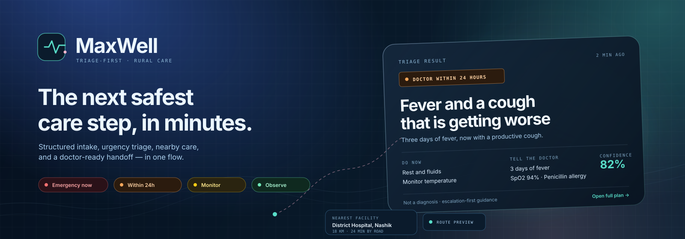
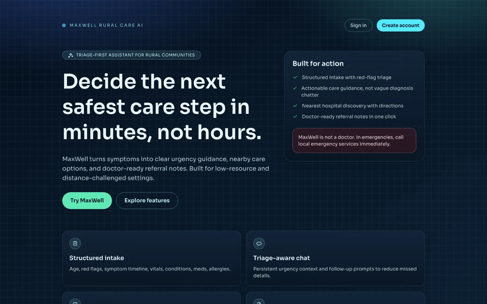
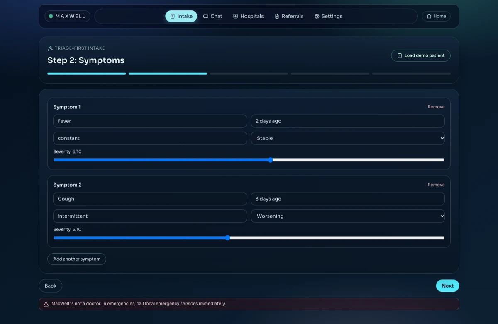
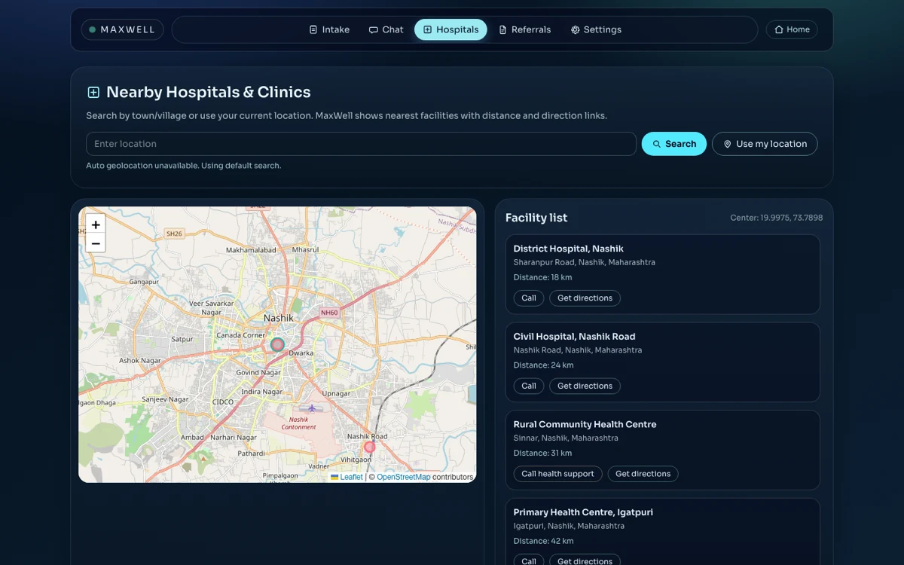
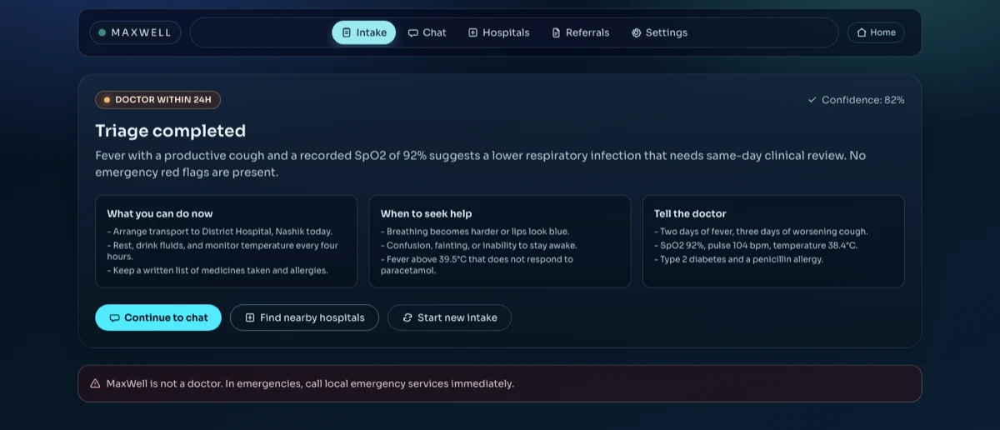
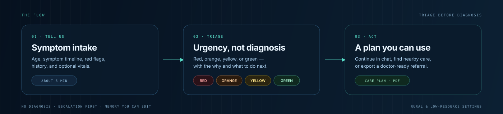
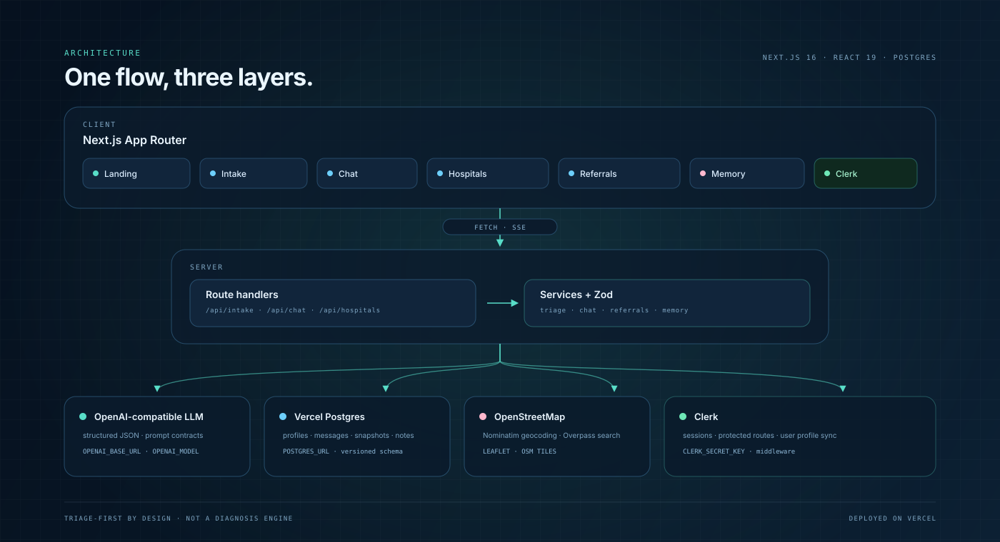

<div align="center">
  
  <br />
  <br />
  <p><strong>Triage-first care navigation for rural and low-resource settings.</strong><br />
  Clear urgency, nearby care, and a doctor-ready handoff — in one flow.</p>

  <p>
    
    
    
    
    
    
    
    
  </p>

  <p>
    
    
    
    
    
  </p>

  <p>
    <a href="https://github.com/Abhinav-Prabhakar/MaxWell/stargazers"></a>
    <a href="https://github.com/Abhinav-Prabhakar/MaxWell/commits/main"></a>
    <a href="https://github.com/Abhinav-Prabhakar/MaxWell"></a>
  </p>
</div>

---

## Product tour



<table>
  <tr>
    <td width="50%" valign="top">
      
      <sub><strong>Structured intake</strong> — symptoms, red flags, history, vitals</sub>
    </td>
    <td width="50%" valign="top">
      
      <sub><strong>Nearby care</strong> — map, distance, contact, and directions</sub>
    </td>
  </tr>
</table>


<sub><strong>Triage result</strong> — urgency, immediate actions, escalation</sub>

## The flow



## Triage levels

| | Level | Response |
|:--:|:--|:--|
| 🔴 | **Emergency now** | Call local emergency services immediately |
| 🟠 | **Doctor within 24 hours** | Arrange same-day or next-day clinical review |
| 🟡 | **Home care + monitor** | Watch closely and seek care if symptoms worsen |
| 🟢 | **Low risk, observe** | Self-care and routine follow-up are appropriate |

## Capabilities

| | Capability | In practice |
|:--:|:--|:--|
| 🧾 | **Structured intake** | Age, symptoms, red flags, conditions, medications, allergies, optional vitals |
| 💬 | **Triage-aware chat** | Persistent urgency and intake context, plus image and PDF attachments |
| 🏥 | **Hospital discovery** | Nominatim + Overpass search, Leaflet map, contact and directions |
| 📄 | **Referral notes** | One-page clinician handoff generated from the intake and chat record, exported as PDF |
| 🧠 | **Editable memory** | Review and correct the facts MaxWell carries into the next conversation |

## Architecture



> Next.js App Router → route handlers → services with Zod contracts → OpenAI-compatible LLM, Vercel Postgres, OpenStreetMap, and Clerk.

## Quick start

```bash
git clone https://github.com/Abhinav-Prabhakar/MaxWell.git
cd MaxWell
npm install

# optional: pull development env vars from the linked Vercel project
vercel env pull .env.local

npm run dev
```

Open **http://localhost:3000**, then use **Load demo patient** on the intake page to explore a complete case without entering data.

### Environment

| Variable | Purpose |
|:--|:--|
| `OPENAI_BASE_URL` | API root for the OpenAI-compatible provider |
| `OPENAI_API_KEY` | LLM access key |
| `OPENAI_MODEL` | Model id used for triage, chat, and referrals |
| `NEXT_PUBLIC_CLERK_PUBLISHABLE_KEY` | Clerk client key |
| `CLERK_SECRET_KEY` | Clerk server key |
| `POSTGRES_URL` | Vercel Postgres connection string |

Run the schema once before the first demo:

```bash
psql "$POSTGRES_URL" -f db/migrations/0001_init.sql
```

### Scripts

| Command | What it does |
|:--|:--|
| `npm run dev` | Start the local development server |
| `npm run build` | Create a production build |
| `npm run start` | Serve the production build |
| `npm run lint` | Run Biome checks |

## Safety

> [!WARNING]
> MaxWell is **not a doctor** and not a medical device. It provides informational, escalation-first triage guidance only. In an emergency, call local emergency services immediately.

<div align="center">
  <sub><strong>No diagnosis · Escalation first · Memory you can edit</strong></sub>
</div>
